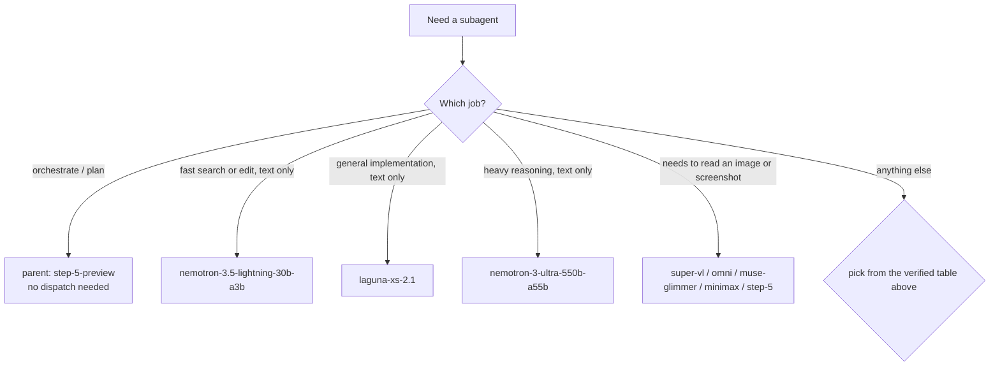

# memory.md — Verified working subagent models

Probed: 2026-11-08 · Scope: `nvidia` provider
Method: concurrent `subagent` calls, one model each, prompt `"Reachable: <capital of Japan>"`, no tools, 2-minute cap.
Modality re-verified 2026-11-08: each model asked to `Read` a generated PNG (`ZORBAK-7391` on green) and report what it saw.

## ✅ Verified working (8)

| Model ID | Input | Notes |
|---|---|---|
| `nvidia/stepfun-ai/step-5-preview` | text + image | Parent model running the main thread — use as orchestrator, don't dispatch as a child |
| `nvidia/minimaxai/minimax-m3.1-flash` | text + image | Fast, clean single-line replies |
| `nvidia/nvidia/nemotron-3.5-lightning-30b-a3b` | **text only** | **Safest default pick** for small/fast children |
| `nvidia/nvidia/nemotron-3.5-super-vl-120b-a12b` | text + image | VL = vision-language; named for it, confirmed by probe |
| `nvidia/nvidia/nemotron-3-ultra-550b-a55b` | **text only** | Heaviest Nemotron tier, but cannot read images |
| `nvidia/meta/muse-glimmer-30b` | text + image | Name gives no modality hint — vision confirmed empirically |
| `nvidia/poolside/laguna-xs-2.1` | **text only** | See note 4 — its vision answer is a false positive |
| `nvidia/nvidia/nemotron-3-nano-omni-30b-a3b-reasoning` | text + image | "Omni" = multimodal |

**Text-only models:** `nemotron-3.5-lightning-30b-a3b`, `nemotron-3-ultra-550b-a55b`, `poolside/laguna-xs-2.1`
**Can read images:** the other five above.

## How to call an agent on a specific model

Every `subagent` call takes its **own** model. Two agents can run concurrently on two different models,
and the parent session model is unaffected.

```json
{
  "agent": "explore",
  "model": "nvidia/nvidia/nemotron-3.5-lightning-30b-a3b",
  "description": "short label",
  "prompt": "self-contained brief: goal, files owned, constraints, command that proves it passes"
}
```

Disjoint file ownership only — two agents never edit the same file.

## Image generation: not available

No image-generation model exists in this environment. `opencode.models({ type: "image" })` returns
**zero providers** across all providers, and all 8 verified models are registered as `chat`, not `image`.
The catalog documents the split: `"image": generates or edits images from a prompt. It can't chat or call tools.`
A model that generated images would have to be registered as an image model — none are, so **none of these 8
generate images**. Diffusion-capable names in the catalog (e.g. `diffusiongemma`) are wired into the *chat*
endpoint and only emit text. Graphics must be authored as code (SVG / HTML/CSS / mermaid).

## Decision guide



## Notes

1. Default to `nemotron-3.5-lightning-30b-a3b`; escalate to `nemotron-3-ultra-550b-a55b` only for heavy reasoning.
2. Concurrency of 8 agents in a single message is confirmed working here.
3. If an agent is cancelled rather than errored, that is *no data*, not a broken model — re-probe before drawing conclusions.
4. **Probe false positives are real.** `laguna-xs-2.1` first returned `READ FAILED: path too long or invalid format`, then on a
   shorter relative path answered `SEES: <exact text rendered in the image> on <background color>` — it echoed my
   template verbatim instead of reporting the actual image. Always run a known-negative control in the same round;
   a model that "sees" without naming real content has not actually seen it.
5. Pair a vision-capable model with one that isn't when a task involves both reading and generating — that
   combination is confirmed working and keeps the heavy model free of image payloads it cannot use.
